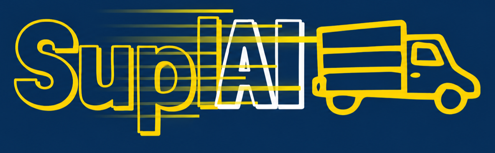
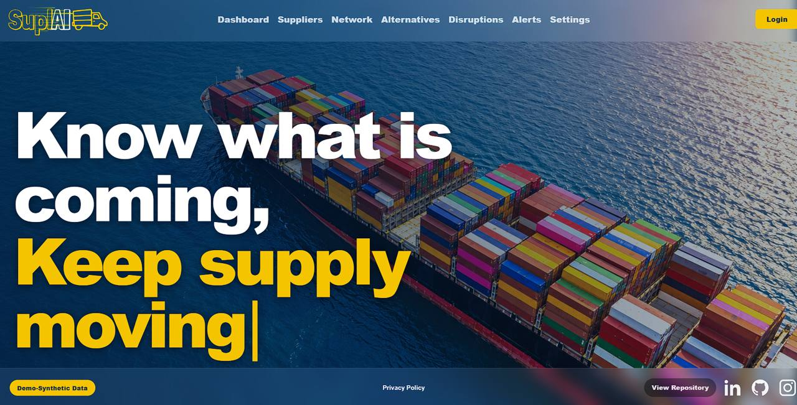
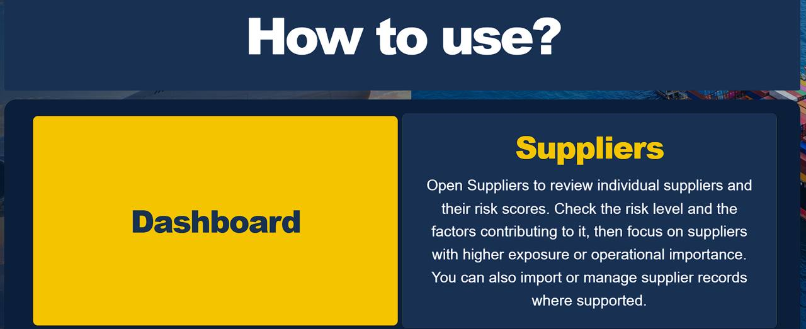
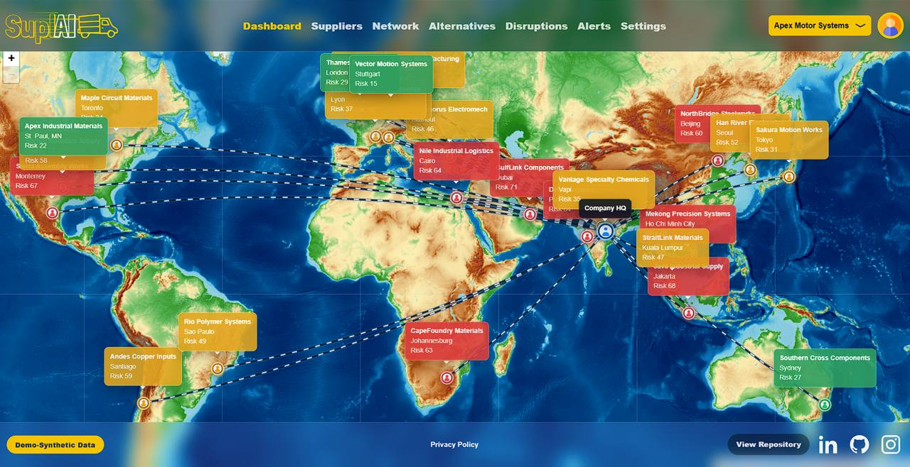
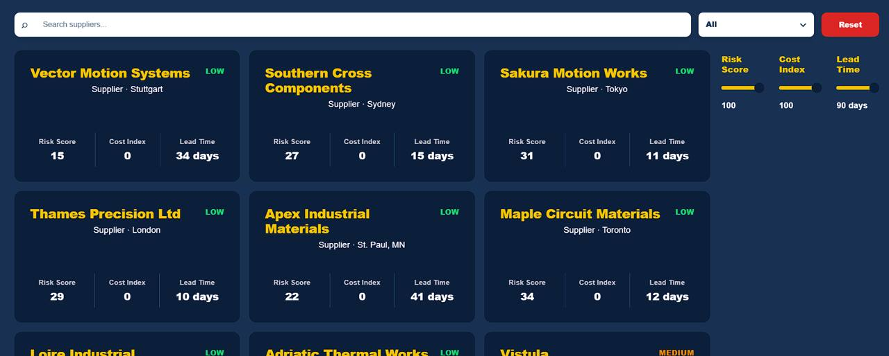
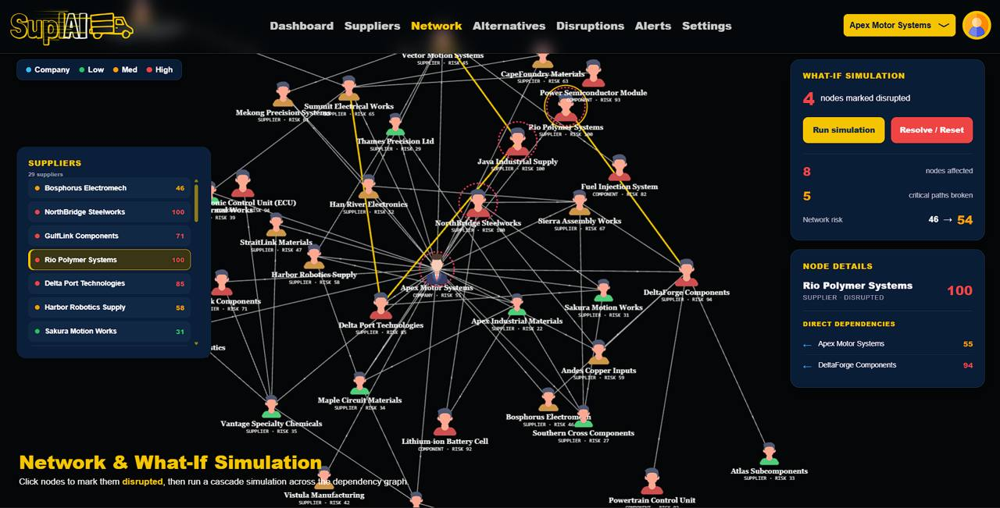
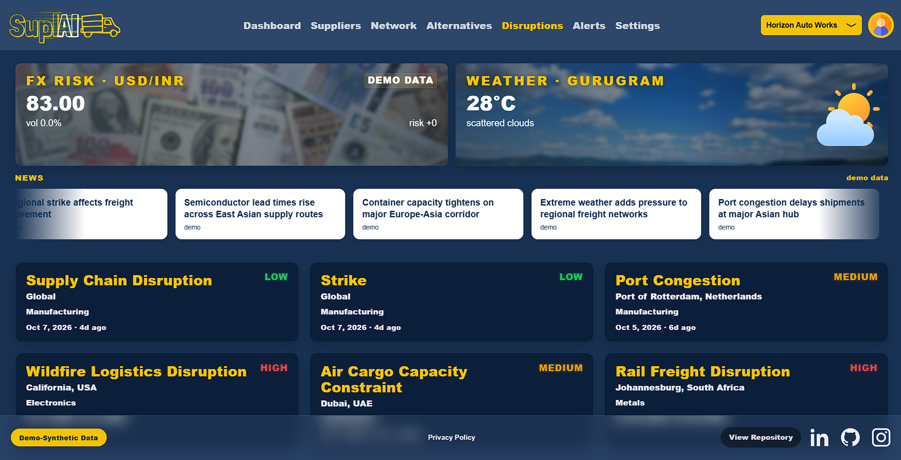
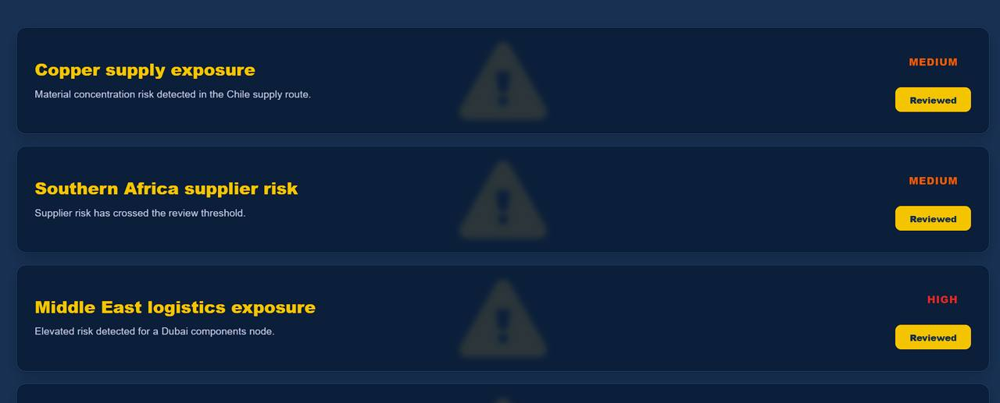
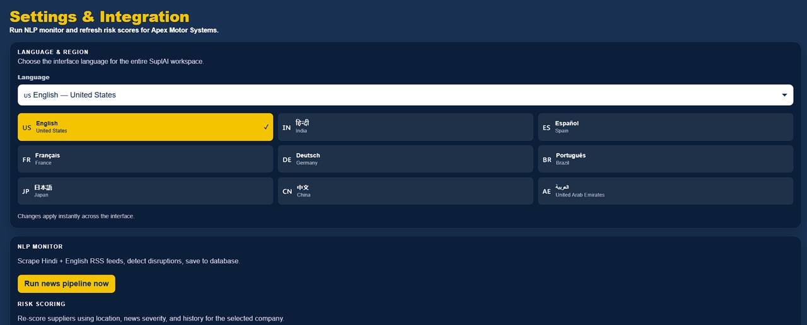
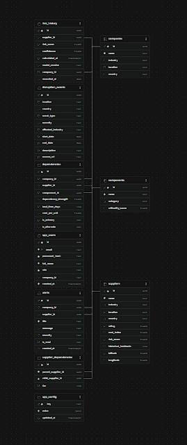

<p align="center">
  
</p>

> **Know what is coming. Keep supply moving.**

SuplAI is an AI-powered **supply-chain risk monitoring platform** that helps businesses monitor suppliers, visualize dependencies, detect disruptions, score risk, and simulate the impact of supplier failures.

<hr>
<p align="center">
  <a href="https://supl-ai.vercel.app/"><strong>Live Demo</strong></a>
  &nbsp; • &nbsp;
  <a href="https://youtu.be/9WQxe0l1aWE"><strong>Demo Video</strong></a>
</p>
<hr>

## Features

- **Supplier Risk Management** — Track risk score, cost index, lead time, and supplier exposure.
- **Global Supply Network** — Interactive map and dependency graph for multi-tier supplier networks.
- **What-If Simulation** — Mark suppliers as disrupted and simulate cascading network impact.
- **Disruption Monitoring** — Track logistics, weather, news, and other supply-chain disruptions.
- **Risk Alerts** — Surface suppliers and events that cross configured risk thresholds.
- **Alternative Suppliers** — Explore alternative sources to reduce dependency risk.
- **NLP Monitoring** — Analyze Hindi and English news feeds for potential disruptions.
- **Multilingual UI** — Supports multiple languages and regions.
- **External Signals** — Weather, FX, geocoding, and news integrations.
- **Demo Mode** — Works with synthetic data for safe demonstrations.

## Screenshots

### Landing Page
The main dashboard introduces SupplAI and provides an overview of the platform.



---

### How to Use
A quick guide to the key workflows and how to navigate the application.



---

### Global Supply Network
Explore supplier locations and visualize connections across the supply network.



---

### Suppliers
Review supplier profiles, risk scores, lead times, and cost-related information.



---

### What-If Simulation
Simulate supplier disruptions and inspect their potential impact on the wider network.



---

### Alternatives
Compare potential alternative suppliers to help reduce dependency on at-risk sources.


---

### Disruptions
Monitor reported events that could affect suppliers, logistics, or supply continuity.



---

### Alerts
View risk alerts highlighting suppliers or events that cross configured thresholds.



---

### Settings
Manage application preferences and configure available integrations.



---

### Database
A visual overview of the database structure supporting SupplAI's data model.

<table>
  <tr>
    <td width="58%" valign="top">
      
    </td>
    <td width="42%" valign="top">
      <h4>Supabase & PostgreSQL</h4>
      <p>SupplAI uses Supabase/PostgreSQL to store supplier, company, dependency, disruption, and risk data.</p>
      <p><strong>Core tables</strong></p>
      <ul>
        <li><code>companies</code> — company records</li>
        <li><code>suppliers</code> — supplier details and risk scores</li>
        <li><code>dependencies</code> — company-to-supplier links</li>
        <li><code>supplier_dependencies</code> — multi-tier supplier relationships</li>
        <li><code>disruption_events</code> — disruption event data</li>
        <li><code>risk_history</code> — historical risk scores</li>
        <li><code>alerts</code> — supplier and company alerts</li>
        <li><code>app_users</code> — application users and roles</li>
        <li><code>app_config</code> — risk thresholds and configuration</li>
      </ul>
      <p><strong>Row Level Security (RLS)</strong></p>
      <p>RLS policies in Supabase should restrict table access according to the authenticated user and their role/company. The repository schema defines the tables and indexes; verify that RLS is enabled and policies are configured for the deployed project.</p>
    </td>
  </tr>
</table>

## Tech Stack

**Frontend:** React, Vite, Leaflet, Recharts, React Force Graph  
**Backend:** Python, FastAPI, NetworkX  
**Database:** Supabase / PostgreSQL  
**Auth & Security:** JWT, role-based access, rate limiting  
**AI/NLP:** NLP-based disruption detection and risk scoring

## Quick Start

### Backend

```bash
pip install -r requirements.txt
python -m uvicorn main:app --host 127.0.0.1 --port 8000 --reload
```

### Frontend

```bash
cd frontend
npm install
npm run dev
```

Create a `.env` from `.env.example` and add the required configuration. The application can also run in **demo mode with synthetic data** when external services are not configured.


> **Note:** The deployed demo uses synthetic supplier, disruption, and risk data.
